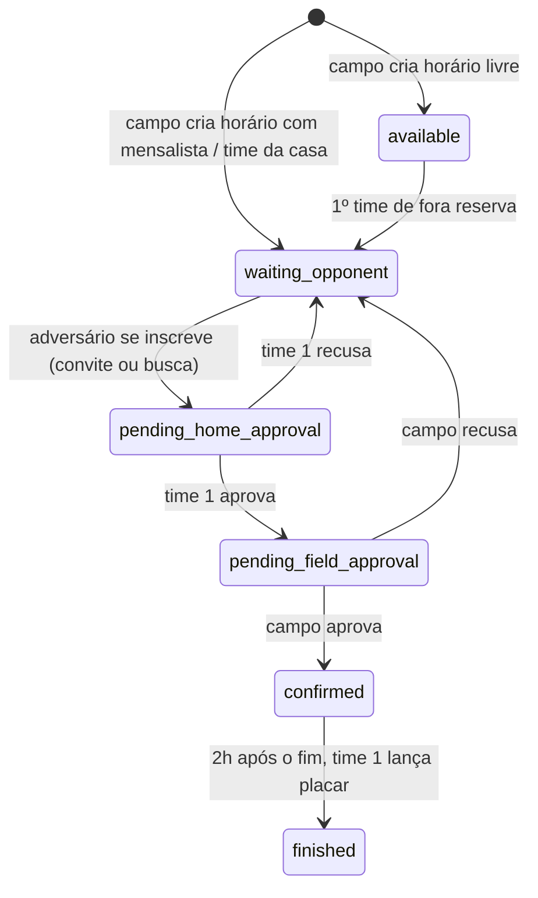

# Jogo Fácil — fluxo de partidas, convites e avaliações

Como o app funciona e o passo a passo para colocar no ar.

## 1. O app é gratuito

Ninguém paga nada: sem mensalidade para times ou campos e sem taxa de jogo.
O app não processa pagamentos. As tabelas e colunas antigas de cobrança (`match_payment`, `billing_*`,
`asaas_*`, `price`, `pix_key`...) continuam no banco só como histórico; nada no app lê ou grava nelas.

## 2. Tipos de jogo

- **Partida Normal**: sem premiação.
- **Festival**: com premiação (campo "Premiação do vencedor", ex.: troféu).
- **Amistoso**.

## 3. Fluxo da partida



- **Time 1** = mensalista/time da casa do horário, ou o primeiro time de fora que reservou.
- O time 1 aprova o adversário. Se o mensalista não tiver conta no app, quem aprova é o dono do campo.
- Ao criar o horário, o dono do campo responde "Tem mensalista ou time da casa neste horário?" e escolhe time e categoria. O jogo aparece direto na agenda desse time (e ele recebe notificação).
- Um time não pode ter 2 jogos da **mesma categoria** no mesmo horário (em casa ou fora). Categorias diferentes podem.
- Até o campo confirmar, o adversário pode desistir e o time de fora pode cancelar a reserva. Depois de confirmado, só o campo cancela.
- 2h depois do fim do jogo: o time 1 recebe aviso para lançar o placar, e os dois times avaliam o adversário e o campo (o aviso automático usa `pg_cron`, ver passo 6).
- Status antigos `pending_payment` e `pending_verification` contam como "aguardando aprovação do campo" (a migração `20261027_01_app_gratuito.sql` converte os que existirem).

## 4. Convites

Dono do campo, mensalista/time da casa ou o time 1 tocam em **Enviar convite**. O app gera um link
(`https://seu-app/?convite=XXXX`) e abre o compartilhamento do celular/WhatsApp com a mensagem pronta.

Quem abre o link vê o jogo (campo, data, categoria) e:
- sem conta: cria uma **conta de time já com a categoria do jogo** e entra direto na inscrição;
- com conta: escolhe o time e se inscreve.

O convite expira no horário do jogo.

## 5. Avaliação

- Nota de 1 a 5 estrelas + tags rápidas (ex.: "Pontual", "Fair play", "Faltou jogador"; para o campo "Gramado bom", "Vestiário sujo"...).
- Cada time avalia o adversário e o campo uma vez por jogo (pode editar).
- As médias aparecem na busca (estrela ao lado do campo) e ficam em `field.rating_avg`, `user.team_rating` e na view `team_rating_summary`.

## 6. Senha

- **Esqueci a senha**: o app envia por e-mail (Resend) um código de 6 dígitos, de uso único, que vale 15 minutos (5 tentativas).
  Sem `RESEND_API_KEY`, a tela leva para o WhatsApp de suporte (`SUPPORT_WHATSAPP`).
- **Troca no perfil**: pede a senha atual.
- **Admin geral** pode definir a senha de outra conta.
- O navegador não consegue gravar a coluna `password`; tudo passa pelo servidor.

### Resend (e-mail do código)

1. Crie a conta em https://resend.com e gere uma API key.
2. Na Vercel, crie `RESEND_API_KEY` com essa chave. **Nunca** coloque a chave no código.
3. Remetente (`EMAIL_FROM`):
   - Sem domínio próprio, o padrão é `Jogo Fácil <onboarding@resend.dev>`. **Atenção:** esse remetente de teste
     só entrega para o e-mail dono da conta Resend. Os outros usuários não recebem o código.
   - Para enviar a qualquer usuário: em Resend > Domains, verifique um domínio seu (o plano grátis permite 1)
     e defina, por exemplo, `EMAIL_FROM=Jogo Fácil <nao-responda@seudominio.com.br>`.

## 7. Arquitetura

```
App (React/Vite)  ──>  Supabase (leitura e cadastros simples)
        │
        └──>  /api (funções da Vercel, com service role)  ──>  Resend (só e-mail de senha)
```

| Arquivo | O que faz |
|---|---|
| `shared/matchRules.ts` | Regras do fluxo (quem aprova, quando libera placar). Usado pela tela e pelo servidor. |
| `api/matches.ts` | Etapas da partida: reservar, se inscrever, aprovar, aprovar pelo campo, cancelar, placar, avaliação. |
| `api/invites.ts` | Cria e abre convites. |
| `api/auth/login.ts` | Login que devolve a sessão usada nas ações do servidor. |
| `api/auth/forgot.ts` | "Esqueci a senha": envia o código por e-mail. |
| `api/auth/reset.ts` | Confere o código e grava a nova senha. |
| `api/auth/password.ts` | Troca de senha no perfil e troca pelo admin geral (só `SUPER_ADMIN`). |
| `api/health.ts` | Diagnóstico da configuração (`/api/health`). |

## 8. Passo a passo para colocar no ar

1. **Banco (Supabase > SQL Editor)**
   1. Habilite a extensão `pg_cron` (Database > Extensions).
   2. Rode `supabase/migrations/20261022_01_fluxo_partidas_pagamentos.sql` (cria convites, avaliações e o aviso pós-jogo; o nome é histórico).
2. **Vercel (Settings > Environment Variables)** — ver `.env.example`:
   - `SUPABASE_URL`, `SUPABASE_SERVICE_ROLE_KEY` (Supabase > Project Settings > API; a service role **nunca** vai para o navegador)
   - `SESSION_SECRET` (texto aleatório longo)
   - `APP_URL` (ex.: `https://jogofacil.app`)
   - `RESEND_API_KEY` e, opcionalmente, `EMAIL_FROM` (ver item 6)
   - `SUPPORT_WHATSAPP` (opcional)
3. **Deploy**.
4. **Depois que a versão nova estiver no ar**, rode, nesta ordem:
   1. `supabase/migrations/20261022_02_endurecimento_colunas.sql` — o navegador deixa de alterar status e placar.
   2. `supabase/migrations/20261023_01_senha_pelo_servidor.sql` — códigos de recuperação e senha só pelo servidor.
   3. `supabase/migrations/20261027_01_app_gratuito.sql` — partidas que esperavam pagamento passam a esperar só o campo.
5. Abra `https://SEU-DOMINIO/api/health` e confira se está tudo OK.

### Rodar localmente

- `npm run dev` sobe só a tela (as ações de partida mostram "Servidor indisponível").
- Para testar tudo: `npx vercel dev` (lê as variáveis de `.env`).
- `npm test` roda os testes das regras; `npm run lint` checa tipos do app e do servidor.
