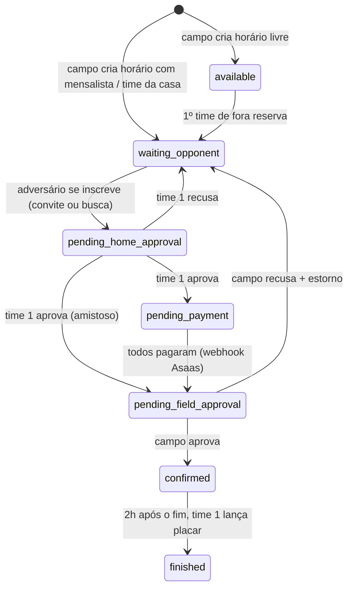

# Jogo Fácil — fluxo de partidas, pagamentos, convites e avaliações

Este documento explica como o app funciona depois da reformulação e o passo a passo para colocar no ar.

## 1. Quem paga o quê

Criar conta e usar o app é **grátis** para todos: não existe mais mensalidade para donos de time nem de campo.
A única cobrança é a **taxa do jogo** que o dono do campo define em cada horário (abaixo).

Assinaturas antigas da mensalidade (Asaas) são canceladas automaticamente pelo webhook quando chega
o próximo evento delas, mas o ideal é cancelá-las no painel do Asaas (Cobranças > Assinaturas).

## 2. Taxa do jogo (paga pelos times, vai para o dono do campo)

| Situação | Quem paga |
|---|---|
| 2 times de fora | 50% cada (taxa R$ 200 → R$ 100 + R$ 100) |
| Mensalista ou time da casa | 100% o adversário (taxa R$ 300 → adversário paga R$ 300) |
| Amistoso | Ninguém (taxa R$ 0) |

O PIX é gerado pelo Asaas com **split**: o valor cai direto na conta Asaas do dono do campo.
A plataforma pode reter uma porcentagem com a variável `PLATFORM_FEE_PERCENT` (padrão 0).

## 3. Tipos de jogo

- **Partida Normal**: sem premiação.
- **Festival**: com premiação (campo "Premiação do vencedor", ex.: troféu).
- **Amistoso**: taxa R$ 0.

## 4. Fluxo da partida



- **Time 1** = mandante do horário (time da casa ou mensalista), ou o primeiro time de fora que reservou.
- O time 1 aprova o adversário. Se o mandante ainda não tem responsável no app, quem aprova é o dono do campo.
- Ao criar ou editar o horário, o dono do campo marca "Tem mandante?", escolhe **time da casa** ou **mensalista**, qual deles e a categoria. O jogo aparece direto na agenda desse time (e ele recebe notificação).
- Horário criado **sem** mandante pode ganhar mandante depois:
  - o dono do campo edita o horário (enquanto nenhum time reservou), ou
  - o responsável pelo time da casa / mensalista daquela arena reserva o horário pelo app: ele entra como **mandante**.
  Nos dois casos o adversário paga **100%** da taxa.
- O mandante pode liberar o horário enquanto ainda não tem adversário.
- Um time não pode ter 2 jogos da **mesma categoria** no mesmo horário (em casa ou fora). Categorias diferentes podem.
- Recusa do campo devolve o horário para a agenda e estorna o que foi pago.
- 2h depois do fim do jogo: o time 1 recebe aviso para lançar o placar, e os dois times avaliam o adversário e o campo (o aviso automático usa `pg_cron`, ver passo 5).

## 4.1 Times da casa e mensalistas (aba "Times" da arena)

O dono do campo cadastra os times dele e manda um **convite** (botões "Copiar convite" e "WhatsApp"):

| | Time da casa | Mensalista |
|---|---|---|
| O campo define | nome, esporte, gênero | dia da semana, horário, duração, quadra, esporte |
| Quem abre o convite | cria a conta (ou entra) e vira o **responsável** pelo time | cria a conta (ou entra), escolhe qual time e **só a categoria** daquele horário |
| Depois de aceitar | o time entra no perfil da pessoa: ela cria categorias e marca jogos em casa e fora | os próximos 8 jogos semanais entram na agenda automaticamente ("Gerar + 8 jogos" cria mais) |

- O link é `https://SEU-DOMINIO/?time=TOKEN`, de uso único. O token fica só no servidor (tabela `team_invite`).
- "Trocar responsável" / "Trocar time" tira a pessoa atual para mandar um novo convite.
- Enquanto ninguém aceitou, o dono do campo já pode criar horários com esse time como mandante; quando a pessoa aceitar, ela assume esses jogos.

## 4.2 Localização da arena e distância

- No cadastro e no perfil da arena, a posição no mapa é salva junto com o endereço (antes era adivinhada a cada busca, e quando falhava caía no centro da cidade).
- Ordem da busca: rua + número → coordenada do CEP → rua → cidade (a cidade aparece como "aproximada").
- O jeito mais preciso é o botão **"Estou na arena"** (GPS do celular), no cadastro, no perfil e no aviso da agenda.
- Arenas antigas sem posição: ao abrir a agenda, o app tenta achar pelo endereço e salva; se não conseguir, mostra o aviso para marcar.
- Para os times: a distância usa a posição salva; se o navegador já tem permissão de localização, calcula sozinho ao abrir.

## 4.3 Configuração de recebimento do dono do campo

O dono do campo vê o botão **Configurar pagamento** (no topo da Arena e na agenda). Ele abre o seu WhatsApp
(`VITE_SUPPORT_WHATSAPP`) com a mensagem: *"Olá, me chamo {nome}, e criei conta no Jogo Facil agora, pode me
ajudar a configurar a conta para receber meus pagamentos?"*.

Para concluir: ajude a pessoa a abrir a conta Asaas dela, pegue o **Wallet ID**, entre no app como admin geral,
"Acessar Conta" do dono do campo → Arena → **Recebimentos** → cole o Wallet ID → Salvar.

## 5. Convites

Dono do campo, mensalista/time da casa ou o time 1 tocam em **Enviar convite**. O app gera um link
(`https://seu-app/?convite=XXXX`) e abre o compartilhamento do celular/WhatsApp com a mensagem pronta.

Quem abre o link vê o jogo (campo, data, categoria, taxa) e:
- sem conta: cria uma **conta grátis de time já com a categoria do jogo** e entra direto na inscrição;
- com conta: escolhe o time e se inscreve.

O convite expira no horário do jogo.

## 6. Avaliação

- Nota de 1 a 5 estrelas + tags rápidas (ex.: "Pontual", "Fair play", "Faltou jogador"; para o campo "Gramado bom", "Vestiário sujo"...).
- Cada time avalia o adversário e o campo uma vez por jogo (pode editar).
- As médias aparecem na busca (estrela ao lado do campo) e ficam em `field.rating_avg`, `user.team_rating` e na view `team_rating_summary`.

## 7. Por que Asaas (e não Mercado Pago)

- **Split nativo** por `walletId`: a cobrança já nasce dividida e o dinheiro do campo cai direto na conta dele, sem a plataforma precisar repassar.
- **Subcontas por API**: o dono do campo cria a conta de recebimento dentro do app (ou informa o Wallet ID se já tiver Asaas).
- No Mercado Pago, o split exige que cada dono de campo conecte a própria conta via OAuth (modelo marketplace), o que dá mais trabalho para você e para ele.

## 8. Arquitetura

```
App (React/Vite)  ──>  Supabase (leitura e cadastros simples)
        │
        └──>  /api (funções da Vercel, com service role)  ──>  Asaas
                    ▲
                    └── webhook do Asaas (/api/webhooks/asaas)
```

| Arquivo | O que faz |
|---|---|
| `shared/matchRules.ts` | Regras do fluxo (quem aprova, quanto cada um paga, quando libera placar). Usado pela tela e pelo servidor. |
| `shared/money.ts` | Formatação de valores em reais. |
| `api/matches.ts` | Todas as etapas da partida: reservar, se inscrever, aprovar, pagar, aprovar pelo campo, cancelar, placar, avaliação. |
| `api/invites.ts` | Cria e abre convites de partida. |
| `api/teams.ts` | Convites de time da casa e mensalista: criar link, ver, aceitar, trocar responsável. |
| `api/payouts.ts` | Conta de recebimento do dono do campo. |
| `api/webhooks/asaas.ts` | Confirmação de pagamentos (idempotente). Cancela assinaturas antigas da mensalidade. |
| `api/auth/login.ts` | Login que devolve a sessão usada nas ações do servidor. |
| `api/auth/forgot.ts` | "Esqueci a senha": envia por e-mail um código de 6 dígitos (uso único, 15 min, 5 tentativas). |
| `api/auth/reset.ts` | Confere o código e grava a nova senha. |
| `api/auth/password.ts` | Troca de senha no perfil (pede a senha atual) e troca pelo admin geral (só `SUPER_ADMIN`). |

## 9. Passo a passo para colocar no ar

1. **Banco (Supabase > SQL Editor)**
   1. Habilite a extensão `pg_cron` (Database > Extensions).
   2. Rode `supabase/migrations/20261022_01_fluxo_partidas_pagamentos.sql`.
2. **Asaas**
   1. Crie a conta (use o **sandbox** primeiro: https://sandbox.asaas.com).
   2. Gere a chave de API (Integrações > Chaves de API).
   3. Para criar subcontas dos donos de campo, peça ao Asaas a liberação de "Contas filhas / white label" na sua conta.
   4. Configure o webhook: Integrações > Webhooks > URL `https://SEU-DOMINIO/api/webhooks/asaas`, token = o mesmo de `ASAAS_WEBHOOK_TOKEN`, eventos de **cobrança**.
3. **Vercel (Settings > Environment Variables)** — ver `.env.example`:
   - `SUPABASE_URL`, `SUPABASE_SERVICE_ROLE_KEY` (Supabase > Project Settings > API; a service role **nunca** vai para o navegador)
   - `SESSION_SECRET` (texto aleatório longo)
   - `ASAAS_API_KEY`, `ASAAS_ENV` (`sandbox` ou `production`), `ASAAS_WEBHOOK_TOKEN`
   - `PLATFORM_FEE_PERCENT` (opcional), `APP_URL` (ex.: `https://jogofacil.app`)
   - `RESEND_API_KEY` e `EMAIL_FROM` (código de recuperação de senha, ver item 11)
4. **Deploy** e teste o fluxo completo no sandbox.
5. **Depois que a versão nova estiver no ar**, rode `supabase/migrations/20261022_02_endurecimento_colunas.sql`.
   Ele impede que o navegador altere status, pagamento, placar e assinatura (só o servidor muda).
   Rode também `supabase/migrations/20261027_01_times_da_casa_e_convites.sql` (times da casa, convites de time e
   mandante no horário). Esta pode rodar antes do deploy.
   Depois do deploy, rode `supabase/migrations/20261027_02_protege_times_do_campo.sql`: o navegador deixa de poder
   definir o responsável de um time ou aprovar pedidos de mensalista (agora feitos pelo servidor).
   Em seguida rode `supabase/migrations/20261023_01_senha_pelo_servidor.sql`: cria a tabela dos códigos de
   recuperação e tira do navegador a permissão de alterar a senha.
6. Troque `ASAAS_ENV` para `production` e a chave de API de produção.

### Rodar localmente

- `npm run dev` sobe só a tela (as ações de partida/pagamento mostram "Servidor indisponível").
- Para testar tudo: `npx vercel dev` (lê as variáveis de `.env`).
- `npm test` roda os testes das regras; `npm run lint` checa tipos do app e do servidor.

## 10. Mudanças de comportamento importantes

- Todos precisam **entrar de novo** uma vez (a sessão agora é validada no servidor).
- A mensalidade dos donos de time (por categoria) foi removida: o app é grátis. Cancele as assinaturas antigas no painel do Asaas e do Mercado Pago.
- O envio de comprovante PIX com verificação por IA foi substituído pelo PIX automático. Jogos antigos que estavam "aguardando validação" ainda podem ser aprovados pelo campo.
- Antes, mensalista dividia a taxa 50/50 — agora o adversário paga 100%, como pedido.

## 11. E-mail do código de senha (Resend)

**Hoje está desligado:** "Esqueci a senha" leva direto para o WhatsApp do suporte (`SUPPORT_WHATSAPP`),
e o admin geral redefine a senha pelo painel. Para religar o código por e-mail, troque
`EMAIL_PASSWORD_RESET_ENABLED` para `true` em `views/Auth.tsx` e siga os passos abaixo.

Usado **só** para o código de recuperação de senha.

1. Crie a chave em https://resend.com e coloque em `RESEND_API_KEY` na Vercel. **Nunca** coloque a chave no código.
2. Verifique um domínio seu em Resend > Domains (registros DKIM, SPF e DMARC no seu provedor de DNS).
3. Defina `EMAIL_FROM` com um endereço desse domínio, por exemplo `Jogo Fácil <nao-responda@SEU-DOMINIO>`.

Sem `EMAIL_FROM`, o padrão é `Jogo Fácil <onboarding@resend.dev>`, que **só entrega para o e-mail dono da
conta Resend**. Sem `RESEND_API_KEY`, o "Esqueci a senha" leva para o WhatsApp de suporte.
